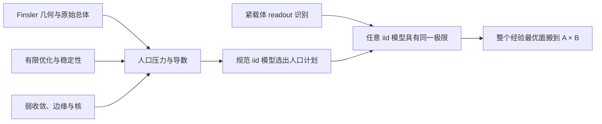

# 代码与证明阅读路线

先读最终定理的短证明，再沿其中实际调用的 lemma 向下展开。通用数学方法按数学领域组织，
应用层只负责把原始几何、总体分布和采样模型接到这些方法。

## 数学接口与技术证明

按数学主题组织定义、基本引理和主要结果。主定理保留完整陈述和由关键 lemma 组成的短证明，
读者可以沿真实调用展开细节。一个主题可以包含多个相关结果，不要求每个 lemma 独占文件。

局部计算适合用 `have` 或同文件的 `private lemma`。可独立复用的数学方法保留为正式 lemma；
较长的估计和构造可放入主题内部的技术文件。特别大的证明可以使用局部 `Proofs/` 目录，
这是本项目的选择。主定理与其最终证明仍在同一声明中，不另造一份重复的公开定理作为包装。

mathlib 的实际例子是 `Analysis/Calculus/ContDiff` 中的 `Defs`、`Basic`、`Comp`、`Bounds`
和 `FaaDiBruno`；后者在同文件中使用私有辅助引理。文件说明列出主要接口和文献出处，
参见 [mathlib 风格指南](https://leanprover-community.github.io/contribute/style.html)。
本项目锁定的 mathlib revision 是 `d77ef0741c6da1ff12df68fb4145ea0ae0850c54`。

已经整理的两个主题可以这样阅读：

| 主题 | 先读的公开接口 | 长证明的实现位置 |
| --- | --- | --- |
| Finsler 测地线 | [`Geodesic/Defs`](../OTSelector/Geometry/Finsler/Geodesic/Defs.lean) 给出 Euler–Lagrange 条件；[`LocalMinimizing`](../OTSelector/Geometry/Finsler/Geodesic/LocalMinimizing.lean) 与 [`Complete`](../OTSelector/Geometry/Finsler/Geodesic/Complete.lean) 给出局部极小性和完整性。 | 同主题 [`Proofs/LocalEquation`](../OTSelector/Geometry/Finsler/Geodesic/Proofs/LocalEquation.lean)、[`Continuation`](../OTSelector/Geometry/Finsler/Geodesic/Proofs/Continuation.lean)、[`MaximalExtension`](../OTSelector/Geometry/Finsler/Geodesic/Proofs/MaximalExtension.lean)。 |
| Whitney 扩张 | [`Whitney/C1`](../OTSelector/Analysis/Calculus/Whitney/C1.lean) 的 `exists_contDiff_one_extension_of_whitney`、[`C11`](../OTSelector/Analysis/Calculus/Whitney/C11.lean) 的 `exists_contDiff_one_lipschitz_fderiv_extension`、[`Lusin`](../OTSelector/Analysis/Calculus/Whitney/Lusin.lean) 的 `exists_contDiff_one_lusin_extension_of_lipschitzOn`。 | 同主题 `Proofs/` 中的覆盖、分割、Hessian、边界和截断构造。 |

这些目录按数学依赖拆分；公开定理直接组合实际辅助结果，细节文件中的可复用结果仍有完整类型。

## 最终定理的 lemma skeleton

[载体定理](../OTSelector/Transport/EmpiricalSelector/Carriers.lean)
证明在原始光滑 Finsler 假设下，存在一个定义在 `A × B` 上的人口最优计划。
这个计划先于所有外部 iid 采样模型选定；整个经验最优集，包括 fractional couplings，
在概率意义下收敛到它。唯一性是被选择的极限或 readout 的唯一性。

| 步骤 | 实际 lemma / 文件 | 对象与结果 |
| --- | --- | --- |
| 构造人口压力 | [`exists_original_population_semidiscrete_pressure`](../OTSelector/Transport/EmpiricalSelector/PopulationPressure.lean) | 从原始总体和几何构造同一校准势的压力、正倾斜区间及零点导数。 |
| 识别人口计划 | [`populationCoupling_eq_of_compact_readouts`](../OTSelector/Transport/EmpiricalSelector/ReadoutUniqueness.lean) | 两个紧支撑耦合的所有连续 readout 相同，推出耦合相等。 |
| 固定计划并统一采样模型 | [`existsUnique_original_general_finsler_selector_with_readout`](../OTSelector/Transport/EmpiricalSelector/WithReadout.lean) | 先用规范 iid 模型固定计划，再由共同 readout 识别任意其他 iid 模型的极限。 |
| 提取存在性 | [`exists_original_general_finsler_empirical_selector`](../OTSelector/Transport/EmpiricalSelector/Existence.lean) | 保留原始长度成本最优性，以及整个经验最优面的收敛。 |
| 回到物理载体 | [`existsUnique_originalGeneralSelectorCarrierLift`](../OTSelector/Transport/EmpiricalSelector/CarrierLift.lean) | 将人口计划与整个经验最优面搬到字面 `A × B`，保留其弱拓扑。 |
| 完成原陈述 | [`exists_original_general_finsler_empirical_selector_on_carriers`](../OTSelector/Transport/EmpiricalSelector/Carriers.lean) | 汇合前述结果，得到任意弱邻域和弱开度量球下的结论。 |

这些文件中的证明是已经实现的 lemma composition；没有待填 `sorry` 的 skeleton。
`WithReadout.lean` 中的 `hu`、`hconv`、`hderiv` 来自构造出的压力，
`populationCoupling_eq_of_compact_readouts` 负责将不同采样模型的结果识别为同一计划。
原文对应 `main.tex` 的 `thm:general-finsler-selector`。

## 通用方法的 lemma skeleton

每条方法保留三部分：`conditions` 记录完整适用条件，`objects` 说明参数及其数学含义，
`proof_detail` 给出中间结论、关键 lemma 和消费者。机器可读版本见
[proof-skeletons.json](proof-skeletons.json)。

| 方法 | 基础模块 | 应用证明保留的工作 |
| --- | --- | --- |
| 同一可行集的最优值比较 | [Analysis/Convex/InfimumComparison](../OTSelector/Analysis/Convex/InfimumComparison.lean) | 指明可行对象，证明目标函数逐项误差界，再调用公共 GLB 比较。 |
| 弱收敛保留闭约束 | [Probability/WeakClosedConstraint](../OTSelector/Probability/WeakClosedConstraint.lean) | 证明关系闭、坐标连续，并给出有限模型的几乎处处约束。 |
| 固定边缘下的弱极限与核识别 | [MeasureTheory/WeakKernelIdentification](../OTSelector/MeasureTheory/WeakKernelIdentification.lean) | 给出真实第一边缘及条件核的收敛；可测权重与积分控制由公共方法处理。 |
| 完整边缘恢复 | [MeasureTheory/WeakInputMarginals](../OTSelector/MeasureTheory/WeakInputMarginals.lean) | 分别支付原始读出误差与伙伴逃逸误差；目标边缘通过坐标交换复用同一技术。 |
| 零行列残差的 gauge 消去 | [Finite/PlanResidual](../OTSelector/Finite/PlanResidual.lean) | 证明残差行列和为零，再应用 gauge cancellation 和加权误差界。 |
| 归一化误差归零 | [Analysis/NormalizedResidual](../OTSelector/Analysis/NormalizedResidual.lean) | 给出误差 majorant 和归一化尺度；绝对值与 squeeze 只证明一次。 |
| 指数衰减压过多项式矩 | [Analysis/PolynomialExponentialThreshold](../OTSelector/Analysis/PolynomialExponentialThreshold.lean) | 提供实际概率指数率和矩界；统一选择 `K = rate + 1`。 |
| 有限点配置 | [PointProcess/FiniteConfiguration](../OTSelector/PointProcess/FiniteConfiguration.lean) | 提供实际有限样本，保留重合点的 multiplicity；不复制 Dirac-sum 构造。 |

## 目录边界与出处

`Analysis`、`MeasureTheory`、`Probability`、`Finite` 和 `PointProcess` 中的通用模块
不依赖 Finsler 选择定理的应用层。`Transport/EmpiricalSelector` 汇集最终论证；
`Reconstruction` 保留仍有独立数学用途的压力、读出和局部到整体构造。
按数学领域建立入口，便于只导入所需部分。

每个基础模块在源码中写明条件、对象、证明步骤和书籍或论文的具体部分。
[公共数学方法与出处](MATHEMATICAL_METHODS.md)及
[机器可读目录](mathematical-methods.json)区分直接经典结果、组合推论、推广和实现适配。
目录说明与文献原命题的差异；文献对应关系不表示书中存在同名 Lean 定理。

公开版本保留当前有效的数学实现；旧 `FinalV*` 包装与重复实现已移除。
当前证明源码的验证与逐文件绑定见 [VERIFICATION.json](VERIFICATION.json) 和
[verified-sources.json](verified-sources.json)。

公开源码及机器目录可直接用于阅读与构建。目录中的 `development-archive://` 只标识开发环境保留的历史源码归档，不是公开构建依赖。
