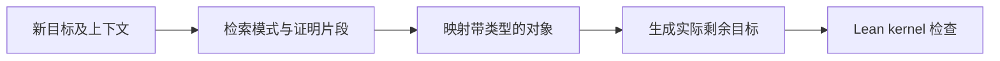

# Proof Atlas

Proof Atlas 把本项目的 Lean 声明、依赖关系和实际证明步骤整理为可查询的本地资料。
工作流程是：检索已有证明 → 显式映射数学对象 → 保留缺少的条件 → 在原 Lean 环境中验证。

每条证明资料围绕三个部分组织：

| 字段 | 内容 |
| --- | --- |
| `conditions` | 原声明的有序条件、实例和假设。 |
| `objects` | 带 Lean 类型的对象；迁移时使用显式 `object_mapping`。 |
| `proof_detail` | 实际证明、使用的声明、来源和可检索的证明步骤。 |

检索结果同时给出声明、证明中间状态和可执行模式的候选。完整证明由 Lean 检查。
FTS5 BM25 与向量 cosine 分别返回；没有混合打分。
内部表达式使用保留共享子项的 DAG；结构匹配只支持明确的一阶片段，超出范围会报告 `unsupported`。



## 建立与查询索引

在仓库根目录运行。导出器读取编译后的 Lean 环境，因此先编译当前源码。
工具需要 Python 3.10 及 numpy；可在自己的 Python 环境中安装基础依赖：

```sh
python3 -m pip install -r tools/proof_atlas/requirements.txt
```

Qwen worker 使用已安装 torch/transformers 的 Python，安装方式见下文。
索引、向量、导出文件和 trace 都放在仓库外；默认位置是同级的 `otselector-index/`。

```sh
lake build
python3 -m tools.proof_atlas build --embedding none
python3 -m tools.proof_atlas status
python3 -m tools.proof_atlas search 'bounded measurable integrable' --view conditions
python3 -m tools.proof_atlas context 'eventual upper bound passes to limit' --compact
```

`--data-dir /absolute/path` 可为各命令指定外部数据目录，环境变量 `PROOF_ATLAS_DATA`
可设置默认目录。索引绑定工作树源码摘要、Lean toolchain 和 mathlib revision。
`build` 用于初次建立或明确要求的全库重建；证明工作期间只增量更新改动模块。
底层 native exporter 支持多个 `--module` / `--project-prefix`，随后以
`Store.import_jsonl(..., replace=False)` 合并，保留其他声明和入边；完整 CLI `build`
即使指定单个 module 仍会替换索引，不能当作增量更新命令。

增量维护同时核对新增模块、已删除声明及 import-only 入口，保留未改记录的历史来源。
Lean 按需生成的同一 `congr_simp` 可能在不同导入环境中归属不同模块；确认类型和证明
依赖相同后保留原来源。定义、签名或实例变化还需更新受影响的依赖模块。
每批 DAG 合并后将 embedding 提交到后台队列：只对缓存中没有的实际 chunk 输入运行模型。
等待期间返回当前关键词结果并标明语义索引待更新。
Tactic trace 按需重提取，历史绑定保留。

按名字查看完整资料，或提取已有导入声明的详细资料：

```sh
python3 -m tools.proof_atlas show OTSelector.Probability.iIndepFun_canonicalX
python3 -m tools.proof_atlas detail OTSelector.Reconstruction.equalMassPartition_of_atomlessClock
python3 -m tools.proof_atlas graph OTSelector.Reconstruction.equalMassPartition_of_atomlessClock \
  --direction upstream --edge-kind proof_ref --depth 2
```

`type_ref` 表示声明类型中的实际引用，`proof_ref` 表示证明表达式中的实际引用。
`graph` 返回有界的依赖子图，并合并递归分量。下游查询使用 `--direction downstream`。

`full_proof` 优先保存经过源码哈希核对的原始 Lean 声明。编译证明 DAG 默认保留最多
2,000 个节点，截断会显式记录；需要完整证明表达式时可对单个声明运行
`detail DECLARATION --proof-budget 0`。结构聚类会跳过截断表达式。

## 中间证明状态与结构比较

`trace` 重新 elaboration 指定源码文件，从 Lean InfoTree 提取实际 tactic 前后状态。
它不会用声明说明文字代替这些中间状态。

`state` 为一个新目标提取同样的有序 telescope 和 Expr DAG，无需先有候选证明。
`context --state` 会自动完成这一步，并给检索结果附上结构匹配结果：

```sh
python3 -m tools.proof_atlas state tools/proof_atlas/examples/contraction-partial.json
python3 -m tools.proof_atlas context --state tools/proof_atlas/examples/integrability-goal.json --compact
```

`elaborated` 表示目标类型检查通过，不表示证明完成。库中已经提供完整与缺条件的收缩示例。

```sh
python3 -m tools.proof_atlas trace \
  OTSelector/Reconstruction/EqualMassPartitionOfAtomless.lean
python3 -m tools.proof_atlas search 'cdf continuous' --view proof_state
python3 -m tools.proof_atlas show --fragment 1
python3 -m tools.proof_atlas duplicates --structural
python3 -m tools.proof_atlas duplicates --structural --proofs
python3 -m tools.proof_atlas compare DECLARATION_A DECLARATION_B --generalize
```

将示例中的 fragment 编号和声明名替换为检索返回的实际值。结构比较保留类型和绑定对象的
关系；公共结构候选仍需明确对象对应、处理条件并经过 Lean 验证。

## 本地语义检索

语义模式支持本地 Qwen worker 和本地 TEI 服务。基础检索与验证不需要启动模型。
Qwen 使用预先准备好的 `Qwen/Qwen3-Embedding-0.6B` 本地权重，工具不会下载模型。
可将可选推理依赖装入独立环境，并显式指定本地模型目录：

```sh
python3 -m venv .venv-embedding
.venv-embedding/bin/python -m pip install torch transformers
export PROOF_ATLAS_WORKER_PYTHON="$PWD/.venv-embedding/bin/python"
export PROOF_ATLAS_QWEN_MODEL_DIR="/absolute/path/to/local/model"
```

模型目录依次取 `--model-dir`、`PROOF_ATLAS_QWEN_MODEL_DIR`，否则使用标准
Hugging Face 缓存中的 `Qwen/Qwen3-Embedding-0.6B` 快照
`97b0c614be4d77ee51c0cef4e5f07c00f9eb65b3`。缓存根目录依次取 `HF_HUB_CACHE`、
`$HF_HOME/hub`、`$XDG_CACHE_HOME/huggingface/hub`，最终默认为
`~/.cache/huggingface/hub`；本地文件缺失时会报错。
TEI 使用 `--embedding tei --embedding-url http://127.0.0.1:PORT`，服务需要另行部署。

`--worker-python`、`PROOF_ATLAS_WORKER_PYTHON` 依次指定推理 Python，默认使用运行
前端的同一个解释器；该解释器需要安装 torch 和 transformers。前端无需导入 Torch。
若前端安装了可选的 `tokenizers` 包，会核对其 backend 指纹后在 CPU
精确分词，并与 GPU 推理异步重叠。分块长度和批大小分别由 `--chunk-tokens`、
`--batch-size` 控制；更改它们不会删除已完成的向量缓存。
同一客户端缓存最近 16,384 个精确输入的 token 数，避免相邻 proof state 重复分词。
完整视图的分块缓存随进度定期提交；即使尚未凑满新的 GPU 批次，中断后也能复用。
分词缓存按视图上下文、文本内容和分块配置复用，向量缓存按模型指纹和实际 chunk 文本
复用。源码文件 SHA、声明 ID 或 manifest 变化而模型输入未变时，无需重新分词或推理；
修改长证明后只推理真正新增的 chunk。旧分词缓存通过一次性校验后的轻量别名迁移。
删除声明后，新一代索引移除其检索行，保留可供其他声明复用的内容缓存。
发布时仍扫描当前视图、组装完整 rows/matrix 并原子替换指针，这部分属于 CPU 和磁盘工作。

```sh
python3 -m tools.proof_atlas.embedding_queue submit --start --device cuda \
  --batch-size 256 --chunk-tokens 1024
python3 -m tools.proof_atlas.embedding_queue status
python3 -m tools.proof_atlas search 'bounded real defect under a strict contraction' \
  --semantic --embedding qwen --model-dir /absolute/path/to/model
```

索引按 `statement`、`conditions`、`objects`、`proof_detail`、`full_proof` 和
`proof_state` 保留不同检索视图。语义分块保存原文位置；向量绑定真实权重、tokenizer、pooling、dtype 和资料内容，
已完成批次可以恢复。源码变化后先增量更新 DAG，再执行队列 `submit`；
模型或分块配置变化时仍检查兼容性，并复用实际输入保持一致的缓存。
查询与状态检查只读取计算源码指纹所需的元数据列，避免为每次校验读取全部证明正文。

`submit --start` 立即返回任务编号，并启动独立会话的持久 worker；已运行的 worker 由文件锁
保持唯一。任务绑定已经合并完成的 DAG 快照，提交和执行均不要求工作树停止修改。
worker 在只读 SQLite WAL 事务中固定当前快照，新的证明与 DAG 写入可以并行。
运行中的任务保留其原来源；若期间 DAG 更新，worker 随后处理最新快照。
相同来源和配置的重复提交会去重，同配置的待处理旧快照会合并为最新版本。

队列、尝试记录、异常和 worker 日志均保存在外部 `--data-dir`，重启会恢复中断的任务。
`status` 返回 `queued`、`running`、`succeeded`、`failed`、`superseded` 状态及来源版本；
`worker.active` 表示是否仍有 worker 持有锁。失败任务保留已完成的向量缓存，显式重试：

```sh
python3 -m tools.proof_atlas.embedding_queue submit --retry FAILED_JOB_ID --start
```

worker 按同一模型配置复用已加载客户端，发布完整 rows/matrix 时仍原子替换指针。
前台单次处理可用 `work --once`；同步补齐仍可使用原 `python3 -m tools.proof_atlas embed`。

## 显式映射和模式迁移

`patterns.json` 是小型、可执行的模式库，包含有限测度下的有界可积性、最终不等式的极限
传递、有限实数的严格收缩归零，以及 ENNReal 无穷值的反例。

```sh
python3 -m tools.proof_atlas patterns
python3 -m tools.proof_atlas patterns nonnegative-real-strict-contraction-zero
```

例如，将下面的状态保存到 `/tmp/proof-atlas-state.json`：

```json
{
  "imports": ["Mathlib"],
  "context": "variable (D κ : ℝ) (hD : 0 ≤ D)",
  "goal": "D = 0",
  "object_mapping": {
    "defect": "D",
    "contraction_factor": "κ"
  }
}
```

```sh
python3 -m tools.proof_atlas match /tmp/proof-atlas-state.json \
  --pattern nonnegative-real-strict-contraction-zero --check
```

模板将这里缺少的 `κ < 1` 和 `D ≤ κ * D` 保留为 Lean 子目标。将它们加入原始
`context` 后，再检查相同目标即可完成证明。模板只替换明确提供的 `{{role}}` 对象，
不改写用户的目标或上下文。也可以用 `--name FULL_DECLARATION_NAME` 试用已索引的声明。

Lean 为每个提供的映射表达式报告实际推断类型，结果放在 `typed_object_mapping`。
类型检查成功并不自动证明某个数学角色与模式统一；最终应用仍由候选证明检查。

## 候选验证接口

`verify` 接收显式候选 JSON；`candidate_kind` 默认为 `tactic`，也可以设为 `term`。

```json
{
  "imports": ["Mathlib"],
  "context": "variable (P Q : Prop)",
  "goal": "P ∧ Q",
  "candidate_kind": "tactic",
  "candidate": "constructor",
  "object_mapping": {"left_proposition": "P", "right_proposition": "Q"},
  "remaining_obligations": ["可选的调用方说明，不作为证明依据"]
}
```

```sh
python3 -m tools.proof_atlas verify /tmp/proof-atlas-candidate.json --timeout 60
```

| `status` | 含义 |
| --- | --- |
| `complete` | 没有未解 metavariable；闭合表达式通过 Lean kernel 检查，传递公理仅限项目允许的三项。 |
| `partial` | 候选产生了实际 Lean 剩余子目标；`kernel_checked` 为 `false`，没有完成证明。 |
| `rejected` | 输入、类型、tactic、编译、公理或运行检查未通过。 |

`remaining_goals` 包含实际的局部上下文与目标；`remaining_goal_types` 是其目标类型。
调用方说明单独保存在 `declared_remaining_obligations`。验证器不会把这些说明当成已解条件，
也不会使用 `sorry`、`admit` 或新增公理填充剩余目标。即使 tactic 丢弃了目标列表，检查器
仍会从根证明表达式追踪未解 metavariable。

每次验证都调用仓库实际的 `lake env lean`，并保留退出码、诊断与检查命令。生成的 Lean
文件位于 `/tmp`，命令结束后删除；验证不会改动项目证明文件。只有 `complete` 能作为
完整候选证明的检查结果。允许的传递公理为 `propext`、`Classical.choice` 和 `Quot.sound`。

## 本地浏览器与验证工具的检查

```sh
python3 -m tools.proof_atlas serve --port 8765 --semantic
python3 -m unittest discover -s tests -p 'test_proof_atlas*.py' -v
```

浏览器默认监听 `127.0.0.1`；上述命令启用本地语义检索，省略 `--semantic` 可使用基础词法检索。
测试覆盖候选检索和结构操作的契约，以及通过真实 Lean 运行的
完整、部分、拒绝三类候选。命令参数以 `python3 -m tools.proof_atlas COMMAND --help` 为准。
